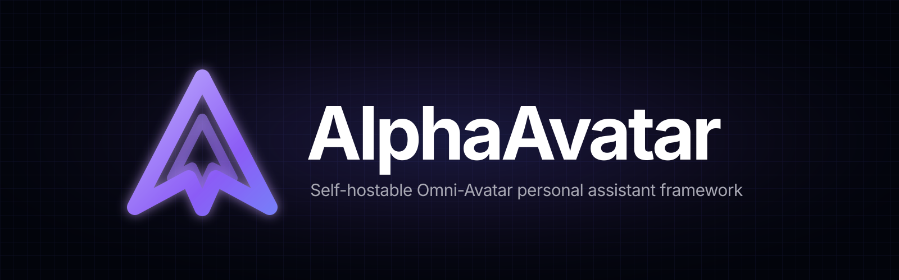
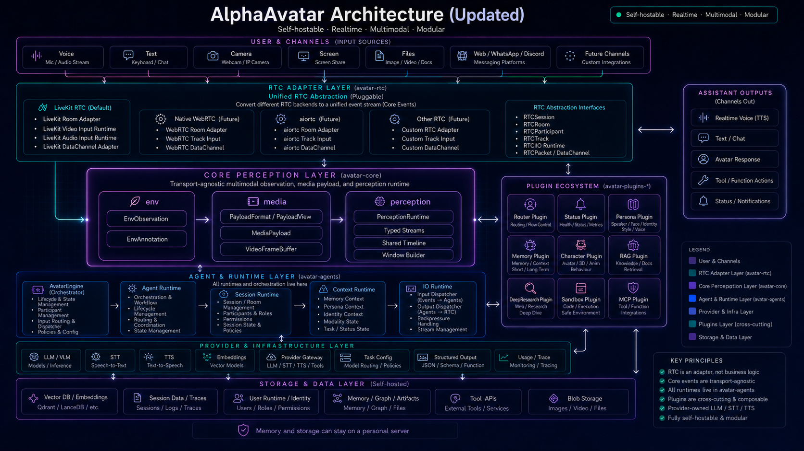

<div align="center"> <a name="readme-top"></a>

<picture>
  <source media="(prefers-color-scheme: dark)" srcset="./.github/banner_dark.svg">
  <source media="(prefers-color-scheme: light)" srcset="./.github/banner_light.svg">
  
</picture>

<br />

[](https://github.com/AlphaAvatar/AlphaAvatar/pulls)
[](https://github.com/AlphaAvatar/AlphaAvatar/commits/main)
[](https://github.com/AlphaAvatar/AlphaAvatar/blob/main/LICENSE)

[](https://GitHub.com/AlphaAvatar/AlphaAvatar/watchers/?WT.mc_id=academic-105485-koreyst)
[](https://GitHub.com/AlphaAvatar/AlphaAvatar/network/?WT.mc_id=academic-105485-koreyst)
[](https://GitHub.com/AlphaAvatar/AlphaAvatar/stargazers/?WT.mc_id=academic-105485-koreyst)


<h3 align="center">
面向每个人的可学习、可配置、可插拔的全模态个人助理
</h3>

<p align="center">
  <a href="https://www.alphaavatar.ai">
    
  </a>
  <a href="https://docs.alphaavatar.io">
    
  </a>
  <a href="https://www.alphaavatar.ai/demo">
    
  </a>
  <a href="docs/ROADMAP.md">
    
  </a>
</p>

<p align="center">
  <a href="https://discord.gg/fAEUtSzRyK">
    
  </a>
  <a href="https://github.com/AlphaAvatar/AlphaAvatar/discussions">
    
  </a>
</p>

</div>

[English](README.md)

---

<h2>AlphaAvatar 简介</h2>

AlphaAvatar 是一个**可自行托管的全模态个人助理框架**，目标是发展为**智能个人管家**：一个持续、个性化、主动的助理，能够记忆、理解、规划，并代表用户采取行动。

它围绕**基于插件的实时 Agent 架构**构建，组合了：

- 🧠 **Memory**：长期保存用户、助理和工具的交互历史
- 🧬 **Persona**：理解用户、保持身份连续性并实现个性化
- 💡 **Reflection**：自我改进与长期行为调整 *（计划中）*
- 📅 **Planning**：任务分解、提醒和面向未来的行动 *（计划中）*
- ⚙️ **Behavior**：回复风格、工作流策略和主动协助 *（计划中）*
- 🧰 **Tools**：通过 MCP、RAG、DeepResearch 和外部集成提供工具
- 😊 **Virtual Character**：实时语音／虚拟形象交互 *（渲染器验证尚待完成）*

✨ **可自行托管，隐私优先**：AlphaAvatar 可以运行在你自己的基础设施上，由你掌控运行时配置、记忆和工具。所选的云端模型、embedding 和远程工具供应商仍需要各自的网络访问和凭据；自行托管框架并不会让这些供应商变成本地服务。

---

<h2>运行时架构 🧠</h2>

<p align="center">
  
</p>

AlphaAvatar 采用分层的实时多模态架构：

- **🎙️ 原生客户端输入**：来自第一方客户端的实时文字、语音、摄像头和屏幕观测。
- **🏠 应用 Host**：组装 Agent 执行和 RTC 适配器，协调它们的生命周期，并承载应用入口。
- **🔌 RTC 适配器**：提供 LiveKit 传输，同时保持应用边界可替换；其他后端尚未实现。
- **👁️ Core 感知**：规范化类型化的多模态观测、来源与片段谱系、有序的感知事件、标注、时间线和历史快照。
- **⚙️ Agent 与运行时**：负责 Turn 准入、原生 Loop 执行、共享状态、能力调用和精确打断。寻址和轮次判断的决定由 Router 单独负责。
- **🧩 插件生态**：提供 Memory、Persona、RAG、MCP、Character 等能力。
- **🧠 Foundation 与基础设施**：提供 ContextManager、Loop、ProviderService 和 VoiceBundle；结构化提取与原生前台流式输出各自保留独立的后端能力。
- **💾 存储与数据**：存储身份、记忆、向量、追踪记录、产物和媒体。
- **📤 助理输出**：通过 OutputRuntime 发布经过校验的 EnvOutput 内容，规范记录流和执行观测流相互独立。Router 协调语音合成／转录文本；RTC 负责交付和播放反馈。

---

<h3>AlphaAvatar 的设计用途</h3>

<table>
<tr>
<td width="50%">

<h4>1️⃣ 个人数据与生活指标管理</h4>

- 📊 跟踪和分析健康、健身、睡眠、学习进度等个人指标
- 📈 提供长期洞察和趋势分析
- 🎯 根据历史规律提出改进建议

</td>
<td width="50%">

<h4>2️⃣ 知识与笔记管理</h4>

- 📖 整理个人笔记、文档和知识
- 🔍 通过 RAG 检索相关信息
- 🧠 逐步构建个人知识库

</td>
</tr>

<tr>
<td width="50%">

<h4>3️⃣ 任务与事件管理</h4>

- 📅 安排任务和提醒
- ⏰ 根据上下文和优先级主动通知
- 🔄 将长期目标分解为可执行的步骤

</td>
<td width="50%">

<h4>4️⃣ 自主规划与执行</h4>

- 🧠 规划学习计划、项目、研究等多步骤工作流
- 🔧 自动调用工具完成任务
- 📌 在较长的时间跨度内保持一致

</td>
</tr>

<tr>
<td width="50%">

<h4>5️⃣ 个性化陪伴与上下文感知</h4>

- 🧬 理解用户的偏好、习惯和性格
- 💬 提供高度个性化的回复
- 🤝 跨对话和模态保持连续性

</td>
<td width="50%">

<h4>6️⃣ 与外部世界交互</h4>

- 🌐 搜索、研究并总结现实世界的信息
- 🧰 集成电子邮件、数据库、API、即时通讯应用等工具
- 🔗 在用户意图与外部系统之间架起桥梁

</td>
</tr>
</table>

> 💡 AlphaAvatar 不只是聊天机器人。
> 它是构建**有状态、主动、多模态且能自我进化的个人 AI 助理**的基础。

---

<h2 id="alphaavatar-plugins">AlphaAvatar 插件</h2>

AlphaAvatar 将插件分为三层：共享的基础服务、感知与交互能力，以及面向外部任务的工具。

*Available 表示已在本源码树中实现，但不一定默认启用，API 也不一定稳定。Planned 的条目尚未作为独立插件提供。*

### ⚙️ 基础层

其他插件通过 `FoundationRuntime` 使用的共享组件。

| 插件 | 能力 | 状态 |
| :--- | :--- | :---: |
| [**Voice**][plugin-voice] | 提供语音活动检测、语音识别和语音合成。<br>与 Router 及其他消费者共享可复用的语音组件。 | ![Available][status-available] |
| [**Provider**][plugin-provider] | 提供由运行时管理的客户端、结构化任务执行、原生 OpenAI Responses 流式输出和受管理的追踪。<br>VDB worker 保留各自对 Embedding 的所有权。 | ![Available][status-available] |
| [**Context**][plugin-context] | 负责原生历史，以及基于捕获状态的查询准备。<br>组合 State、感知、Memory 和 Persona，不在每一步改写前缀。 | ![Available][status-available] |
| [**Loop**][plugin-loop] | 运行原生的模型／工具执行，带有上限、显式授权和规范记录发布。<br>AvatarEngine 依赖此插件。 | ![Available][status-available] |

FoundationRuntime 拥有 ContextManager、Loop、ProviderService 和 VoiceBundle。Memory 和 Persona 借用结构化任务网关，同时保留由处理器自己维护的配置和业务提示词。前台 Loop 显式选择流式后端；LangChain 任务后端不会因为共享该服务而具备流式能力。

### 🧠 感知层

用于理解用户、维护记忆和协调交互的能力。

| 插件 | 能力 | 状态 |
| :--- | :--- | :---: |
| [**Router**][plugin-router] | 协调多模态路由、寻址、轮次判断和打断。<br>结合语音、转录文本和注意力证据做出实时交互决定。 | ![Available][status-available] |
| [**Memory**][plugin-memory] | 从对话、工具和环境观测中保存持久记忆。<br>检索相关信息，在多次交互之间保持连续性。 | ![Available][status-available] |
| [**Persona**][plugin-persona] | 构建用户画像，识别说话者和人脸。<br>保持身份连续性，并为个性化提供上下文。 | ![Available][status-available] |
| [**Character**][plugin-character] | 原生的 AIRI 浏览器生命周期，带限定范围的传输就绪状态和独立的前端托管。<br>使用已有的 Agent 音频；示例中保持禁用。渲染器／RTC 验证尚待完成。 | ![Pending][status-pending] |
| [**Status**][plugin-status] | 发布就绪状态、模型／工具活动和交付结果。<br>支持可选的语音播报，不强制播放通用的语音等待提示。 | ![Available][status-available] |
| **Reflection** | 将回顾记忆、行为和交互历史。<br>将从中得出洞察，支持持续的调整和改进。 | ![Planned][status-planned] |
| **Planning** | 将把目标转化为协调一致的多步骤计划。<br>将跟踪任务进度，支持更长周期的执行。 | ![Planned][status-planned] |
| **Behavior** | 将管理回复风格、工作流策略和主动行为。<br>将根据用户偏好和上下文调整交互策略。 | ![Planned][status-planned] |

### 🧰 工具层

用于研究、文档访问和外部操作的集成。

| 插件 | 能力 | 状态 |
| :--- | :--- | :---: |
| [**MCP**][plugin-mcp] | 发现、检索并调用 MCP 服务器提供的工具。<br>将助理连接到外部服务和现实世界中的操作。 | ![Available][status-available] |
| [**DeepResearch**][plugin-deepresearch] | 结合网页搜索和内容提取进行多步骤研究。<br>基于外部信息生成有依据的回复。 | ![Available][status-available] |
| [**RAG**][plugin-rag] | 导入文档，为模型回复检索相关知识。<br>将上传的内容接入检索增强工作流。 | ![Available][status-available] |
| **Sandbox** | 将为外部操作提供隔离执行。<br>将支持与工具及其他 Agent 的受控交互。 | ![Planned][status-planned] |

开发细节见[插件布局与边界](avatar-plugins/README.md)。

[plugin-voice]: avatar-plugins/foundation/avatar-plugins-voice/README.md
[plugin-provider]: avatar-plugins/foundation/avatar-plugins-provider/README.md
[plugin-context]: avatar-plugins/foundation/avatar-plugins-context/README.md
[plugin-loop]: avatar-plugins/foundation/avatar-plugins-loop/README.md
[plugin-router]: avatar-plugins/perception/avatar-plugins-router/README.md
[plugin-memory]: avatar-plugins/perception/avatar-plugins-memory/README.md
[plugin-persona]: avatar-plugins/perception/avatar-plugins-persona/README.md
[plugin-character]: avatar-plugins/perception/avatar-plugins-character/README.md
[plugin-status]: avatar-plugins/perception/avatar-plugins-status/README.md
[plugin-mcp]: avatar-plugins/tools/avatar-plugins-mcp/README.md
[plugin-deepresearch]: avatar-plugins/tools/avatar-plugins-deepresearch/README.md
[plugin-rag]: avatar-plugins/tools/avatar-plugins-rag/README.md
[status-available]: https://img.shields.io/badge/Available-28a745?style=flat
[status-planned]: https://img.shields.io/badge/Planned-6c757d?style=flat
[status-pending]: https://img.shields.io/badge/Pending-d29922?style=flat

---

<h2>最新动态 🔥</h2>

- [2026/11] 发布 AlphaAvatar **[0.6.9 版本](docs/releases/v0.6.9.md)**：新增自带 Python 的 Linux 安装包、交互式 Setup、bundle、profile 与已存储的凭据、向前升级与清理，以及带延迟和 runner 指标的 Doctor 诊断；明确了转录期限、整句级轮次判断、参与者归属、Memory 检索和 embedding 空间保护，并新增可配置的 runner worker 数量。
- [2026/10] 发布 AlphaAvatar **[0.6.8 版本](docs/releases/v0.6.8.md)**：完成由 AlphaAvatar 自有的原生 Host 和流式 Agent 运行时，移除 LiveKit Agents SDK，将 RTC 接入与执行所有权分开，引入由处理器负责的 Persona 和 Memory、运行时能力和已提交 Turn 的消费者、同步的 PCM 语音与字幕、结构化诊断，以及 Python 3.13 工具链。
- [2026/09] 发布 AlphaAvatar **0.6.7 版本**：新增 AlphaAvatar 自有的多模态轮次判断、按说话者维护对话焦点的本地语义寻址、类型化的寻址证据与融合、由标注驱动的精确轮次快照、全双工打断，并移除了 LiveKit 文本轮次检测和旧的声学唤醒链路。
- [2026/08] 发布 AlphaAvatar **0.6.6 版本**：新增统一的时间对齐多模态运行时、自适应的音视频 ENV Memory、与供应商无关的模型输入、运行时能力感知、基于时间的感知保留、按参与者划分的时区上下文，以及按日期分组的会话存储。
- [2026/07] 发布 AlphaAvatar **0.6.4 版本**：新增与传输无关的感知运行时，包括类型化多模态流、共享时间线、带标注的载荷视图，以及从实时视觉观测中在线提取 ENV 记忆。
  - 发布 AlphaAvatar **0.6.5 版本**：新增共享的实时音频感知、Interaction Router、AlphaAvatar 原生的 VAD 和 STT、按 runner 隔离的推理进程，并将 AlphaAvatar 的全部 VDB 工作负载从 LiveKit 的共享推理执行器迁出。

- [2026/06] 发布 AlphaAvatar **0.6.0 版本**：新增 **Status 插件**、采样视觉输入支持，以及带状态感知的 DeepResearch / RAG / MCP 工具反馈。
  - 发布 AlphaAvatar **0.6.1 版本**：为 Persona 新增视觉身份支持，包括人脸检测、人脸向量匹配、说话者与人脸的身份融合，以及若干缺陷修复。
  - 发布 AlphaAvatar **0.6.2 版本**：引入统一的 Provider 层、嵌套配置、Provider 追踪，以及更清晰的会话／运行时基础，为将来的多用户多模态记忆做准备。
  - 发布 AlphaAvatar **0.6.3 版本**：新增首个**图感知的 Memory 基础**，包括多对象记忆条目、会话范围内的图节点提及、LanceDB 图节点检索、支持别名的图查找，以及更清晰的会话内容记忆提取提示词。

- [2026/05] 发布 AlphaAvatar **0.5.4 版本**：
  - 新增**基于 LanceDB 的 MCP 工具检索**，使 AlphaAvatar 能根据 Agent 查询语义搜索相关的 MCP 工具。
  - 重构**系统提示词与运行时提示词的组合**，改进 Persona 运行时状态追踪，新增从临时用户到真实用户的身份合并，并改进 RAG 运行时行为。
  - 发布 AlphaAvatar **0.5.5 版本**：修复生产 `start` 模式下的**推理 runner 注册生命周期**，确保插件 runner 在配置解析之后、LiveKit 创建推理执行器之前完成注册。

- [2026/04] 发布 AlphaAvatar **0.5.3 版本**：
  - 为 Memory 插件新增本地化的 Markdown 备份。
  - 新增 LanceDB，作为未提供 Qdrant 凭据时默认的本地 VDB 选项。

- [2026/03] 发布 AlphaAvatar **0.5.0 版本**：
  - 新增 MCP 插件，支持检索和并发调用 MCP 工具。
    - 发布 AlphaAvatar **0.5.1 版本**：新增最初的基于 Baileys 的 WhatsApp 桥接。这是一个历史里程碑；外部消息桥接已从 v0.6.8 开发线中移除。
  - 发布 AlphaAvatar **0.5.2 版本**：新增 AlphaAvatar Voice 插件，支持 [Voice.ai](https://voice.ai/) TTS。

- [2026/02] 发布 AlphaAvatar **0.4.0 版本**：
  - 通过 [RAG-Anything](https://github.com/HKUDS/RAG-Anything) 新增 RAG 支持。
  - 优化 Memory 和 DeepResearch 模块。
  - 发布 AlphaAvatar **0.4.1 版本**：修复 Persona 插件的缺陷，并新增一个 MCP 插件。

- [2026/01] 发布 AlphaAvatar **0.3.0 版本**：
  - 通过 [Tavily](https://tavily.com) API 新增 DeepResearch 支持。
  - 发布 AlphaAvatar **0.3.1 版本**：新增用户与助理交互过程中的工具调用记忆提取。

<details>
<summary>2025 年发布历史</summary>

- [2025/12] 发布 AlphaAvatar **0.2.0 版本**：
  - 新增基于 [AIRI](https://github.com/moeru-ai/airi) Live2D 的虚拟角色展示。

- [2025/11] 发布 AlphaAvatar **0.1.0 版本**：
  - 新增自动记忆提取。
  - 新增自动的用户画像提取与匹配。

</details>

<br/>

<h2>安装与使用 ⚙️</h2>

<h3>🖥️ 服务器</h3>

Linux x86_64，glibc 2.28 或更新版本，安装最新发布版本：

```bash
curl -fsSL https://github.com/AlphaAvatar/AlphaAvatar/releases/latest/download/install.sh | bash
```

安装器会询问是否立即运行 `alphaavatar setup`。之后按其 `Next` 下的提示，或在新终端中运行：

```bash
alphaavatar setup    # only if setup was skipped or did not finish; or config init <bundle> --avatar-id <id>, then setup <bundle>
alphaavatar doctor   # static checks, then the runtime diagnosis in rounds, once you agree to it
alphaavatar start    # runs the bundle setup enabled
```

开发时从源码安装（默认分支，包含尚未发布的改动）：

```bash
git clone --recurse-submodules https://github.com/AlphaAvatar/AlphaAvatar.git
cd AlphaAvatar && uv sync --all-packages --locked && source .venv/bin/activate
cp .env.template .env.dev    # then fill in the credentials
ENV_FILE=.env.dev alphaavatar config init my-avatar --avatar-id my-avatar
ENV_FILE=.env.dev alphaavatar doctor
ENV_FILE=.env.dev alphaavatar dev
```

其他版本与镜像、某个发布版本的源码、无人值守安装、凭据、升级以及以服务方式运行，见 [DEPLOY.md](docs/DEPLOY.md)；每条命令见 [docs/cli](docs/cli/)；完整配置见[示例](examples/README.md)；开发环境见 [CONTRIBUTING.md](CONTRIBUTING.md)。

<h3>💻 笔记本电脑</h3>

<h3>📱 移动设备</h3>
