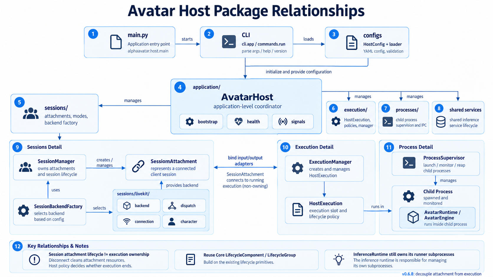
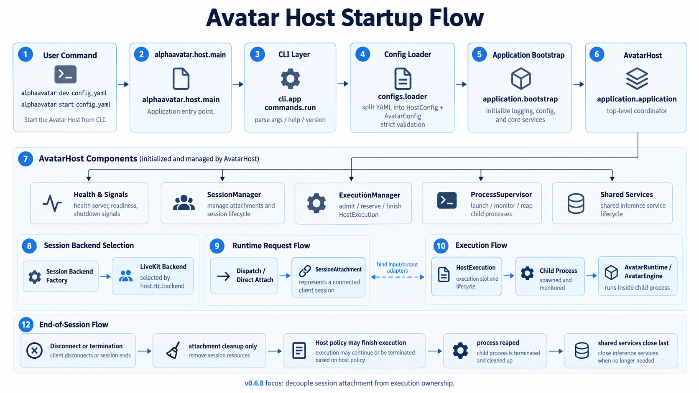

# AlphaAvatar Host

`alpha-avatar-host` owns application startup, shared inference and hosted execution.
`sessions/` owns interaction attachments; `sessions/livekit/` implements the LiveKit backend.
Core, Agents and RTC do not depend on Host. App is not required to run the command.

## 📦 Package structure

<p align="center">
  
</p>

```text
alphaavatar/host/
├── main.py                         # Public command entrypoint.
├── version.py                      # Package version.
├── cli/
│   ├── app.py                      # Arguments, help, version and command routing.
│   └── commands/run.py             # Native dev/start commands.
├── configs/
│   ├── application.py              # Combined Host/Avatar configuration.
│   └── loader.py                   # Strict loading and resolved child snapshots.
├── application/
│   ├── application.py              # AvatarHost and shared-service ownership.
│   ├── bootstrap.py                # Child-side Runtime/Engine/session assembly.
│   ├── config.py                   # Host settings and health configuration.
│   ├── health.py                   # Liveness, readiness and bounded status.
│   └── signals.py                  # Process signals to an owned stop request.
├── execution/
│   ├── execution.py                # Child-local HostExecution: Engine + Runtime.
│   ├── manager.py                  # Parent-side admission and execution handles.
│   ├── policy.py                   # Session-end and control-loss policies.
│   ├── schemas.py                  # Reservations, states and execution views.
│   └── stop.py                     # Stop notification with a first-request reason.
├── processes/
│   ├── supervisor.py               # Execution subprocess supervision.
│   ├── process.py                  # One child, authenticated IPC and reaping.
│   ├── entrypoint.py               # Internal child entrypoint; not a public CLI.
│   ├── channel.py                  # Bounded IPC framing.
│   ├── config.py                   # Capacity and process timeouts.
│   └── schemas.py                  # Versioned launch, control and result messages.
└── sessions/
    ├── base.py                     # Backend and connection contracts.
    ├── factory.py                  # Configuration validation and lazy selection.
    ├── manager.py                  # Child-local execution/attachment binding.
    ├── attachment.py               # Transport, adapters and presentation ownership.
    ├── mode.py                     # Text, audio and video interaction modes.
    ├── config.py                   # Backend selection settings.
    ├── schemas.py                  # Requests, participant context and end events.
    └── livekit/
        ├── backend.py              # Dispatch/direct access and adapter assembly.
        ├── config.py               # LiveKit settings and credential validation.
        ├── dispatch.py             # Native control protocol; no SDK worker pool.
        ├── connection.py           # One RTC connection and its events.
        └── character.py            # Scoped renderer credentials and readiness.
```

Ordinary package initializers are omitted. `execution/schemas.py`,
`processes/schemas.py` and `sessions/schemas.py` are files, not directories.

## Run

The sole public entrypoint is `alphaavatar.host.main:main`:

```bash
alphaavatar --help
alphaavatar --version
ENV_FILE=.env.dev alphaavatar dev examples/agent_configs/mm/pipeline_openai_tools.yaml
alphaavatar start examples/agent_configs/mm/pipeline_openai_tools.yaml
```

`dev` enables DEBUG logging and an ephemeral health port by default; it does not
watch files or restart executions. `start` defaults to INFO and health port 8081.
Help and version do not initialize models, inference, RTC or credentials. Overrides
remain `key=value` arguments after the filename. Installer, TUI and Doctor are not
implemented by these commands.

## Connection modes

| Mode | Room source | Host lifetime |
| --- | --- | --- |
| `dispatch` (default) | Named LiveKit dispatch assignment. | Continues accepting new jobs after individual executions end. |
| `direct` | Explicit `room_name` in Host configuration. | Runs one execution, then exits and releases shared services. |

Both modes use the same execution supervisor and child-side assembly. `direct`
still connects to LiveKit; it is neither peer-to-peer nor offline operation.
Connection mode is independent of `dev/start` and participant `session_type`.

See [Host operation](../docs/worker-hosting.md) for credentials, complete mode
examples, participant selection, timeouts, health endpoints and rollout instructions.

## Ownership and diagrams

<p align="center">
  
</p>

The English diagrams are maintained as Mermaid source with explicit process
boundaries. Earlier PNG concept sketches in the same asset directory are not the
current lifecycle specification.

AvatarHost owns shared inference and parent-side ExecutionManager/ProcessSupervisor.
The parent holds execution handles, not child Engine objects. Each execution child
creates HostExecution, SessionManager and its single SessionAttachment.

SessionManager starts Character readiness, outputs, Engine and inputs in that order.
Detachment releases the attachment's adapters, subscriptions, presentation and
connection; it does not close HostExecution. The Host's `finish_execution` policy
then settles Engine and Runtime. Shared inference closes only when the entire Host
shuts down, after execution children are reaped. InferenceRuntime remains the sole
owner of its own serial runner processes. Core lifecycle and managed cleanup are reused.

## Control loss and result semantics

`host.execution.on_control_loss: finish_execution` is the only supported control-loss
policy. Losing a registered LiveKit control connection makes the backend unready,
cancels its outstanding reservations and asks Host to stop and reap the exact
assigned executions. Only then may a fresh registration accept new jobs. Shared
inference remains alive unless the whole Host must stop.

A new worker registration does not restore old job ownership. Old jobs are not
replayed, resumed or reported as belonging to the new registration. There is no
unverified migration/resume switch. This deliberately ends affected conversations
even when their RTC media connection is still alive.

`stop_reason` retains the first accepted stop request independently of final
`outcome` and `reason`. A cleanup error or forced kill cannot turn an unknown tool
result into success; process `success` means orderly lifecycle completion, not proof
that every tool succeeded or that the user heard every response. Bounded recent
execution views are available at `/status`; protect the health service from public access.

## Current limits

One attachment per execution is supported; reattachment, persistent Episodes,
restart recovery, sleep/wake and Dream scheduling are not. Detachment never implies
room deletion. Dedupe is bounded and process-local, not durable exactly-once execution.

The `livekit` extra installs RTC/API/protocol libraries, not the Agents SDK.
Real LiveKit/server/client/provider validation is still required before deployment.
Optional presentation follows [Character setup](../avatar-plugins/perception/avatar-plugins-character/README.md).
