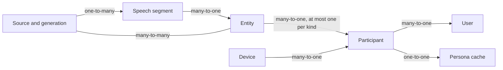

# AlphaAvatar identifier and association conventions

[中文](identifiers-zh.md)

This document explains each identifier by the function it serves in the application: its meaning, owner, uniqueness scope, lifetime and initialization entry. It describes the current temporal input window implementation: turn-taking consumes perception observations and annotations and proposes actions, Engine admits the input and Core commits the Turn; recognizing people and accepting identities are not done by turn-taking.

A field name is interpreted together with the type that owns it. A uniqueness scope is not an access permission: knowing an ID does not mean the user data it points to may be read. The initialization entries in the tables also distinguish automatic generation, caller-provided values, reuse of an existing reference and provider mapping.

## 1. Application and connection: locating the Avatar, session and Host execution

| Field | Meaning and owner | Uniqueness scope and lifetime | Initialization entry |
| --- | --- | --- | --- |
| `avatar_id` / `avatar.id` | The identity of the configured Avatar instance; it selects the Workspace and is the owner of Avatar Memory. | Application configuration namespace; not the same as `agent_device_id`, the device through which the Avatar connects to RTC. | Provided by the caller through the [Avatar configuration](../avatar-agents/alphaavatar/agents/configs/avatar_info_config.py); the Workspace is assembled from that configuration. |
| `session_id` | The session identifier of Core `SessionRuntime`; it associates participants, events and the session directory. | Identifies one Session within its owning runtime environment; a UUID by default, or provided explicitly by the caller. | [SessionRuntime.__init__()](../avatar-core/alphaavatar/core/session/runtime.py). |
| `execution_id` | One execution instance managed by Host, held by the execution manager. | Scope of start, stop and status queries in the Host execution manager; different from `run_id`, which identifies one model loop. | [ExecutionManager.reserve()](../avatar-host/alphaavatar/host/service/execution/manager.py) generates its own UUID. |
| `attachment_id` | Identifies one connection attachment of the session backend; it associates the request with the end notification. | One attachment; a re-established connection is not interpreted as a new person, and it is not `execution_id` or `session_id`. | `ExecutionManager.reserve()` generates its own UUID; the backend writes it into `SessionRequest`, and the end notification reuses it. |
| `lease_id` | Identifies an execution reservation lease, held by the Host reservation flow. | Validated together with the reservation, its source and its expiry time; once a reservation is no longer valid, an execution cannot be started from the old lease. | `ExecutionManager.reserve()` generates its own UUID and writes it into [ExecutionReservation](../avatar-host/alphaavatar/host/service/execution/schemas.py). |
| Host `source_id` | The backend dispatch source in `SessionRequest` and `ExecutionReservation`. | `(backend, source_id)` associates reservations and deduplicates them; a different namespace from the media `PerceptionSourceRef.source_id`. | [LiveKitBackend.serve()](../avatar-host/alphaavatar/host/service/sessions/livekit/backend.py) generates a UUID in direct mode; in dispatch mode [LiveKitDispatch](../avatar-host/alphaavatar/host/service/sessions/livekit/dispatch.py) uses the server's `job.id`. |

- `execution_id`, `attachment_id` and `session_id` describe the execution instance, the connection attachment and the session respectively; they cannot substitute for one another just because they currently happen to correspond one to one.
- Session close is not a common end condition for an Episode or a Context, and does not mean all long-term data has been saved. These IDs by themselves do not promise to recover tasks across processes.
- The session directory's date comes from `SessionRuntime.created_at`; it cannot be derived from `session_id` or a device time string.

## 2. Person association: distinguishing devices, perceived entities, participants and users

| Field | Meaning and owner | Uniqueness scope and lifetime | Initialization entry |
| --- | --- | --- | --- |
| `device_id` | Device identifier supplied by the transport adapter layer; one device can provide text, microphone, camera and rendering connections. | Namespace of the current transport backend, for example a LiveKit room; not a hardware serial number, and a re-attachment may reuse or change it. | The RTC input adapters map LiveKit `participant.identity` to `device_id`; see [audio input](../avatar-rtc/alphaavatar/rtc/livekit/audio/input.py) and [video input](../avatar-rtc/alphaavatar/rtc/livekit/video/input.py). |
| `agent_device_id` | A role-qualified reference to the Avatar's own connecting device; still a `device_id`. | Corresponds to the current connection; not the same as `avatar_id`. | Provided by the connection configuration or during backend assembly; carries the device identity. |
| `entity_id` | A perceived entity labelled by a tracker: one face or one voice. | Unique within one Session; the same entity can appear on several sources and generations and corresponds to exactly one participant; its ID is not reused after it retires. Entities are created only by Persona's trackers; an observation (`EnvObservation`) carries no entity: the entity of a speech segment is the association Persona gives it, and the entity of a face is in the face annotation. | Persona's [face tracking](../avatar-plugins/perception/avatar-plugins-persona/alphaavatar/plugins/persona/processors/face/tracking.py) and [speaker tracking](../avatar-plugins/perception/avatar-plugins-persona/alphaavatar/plugins/persona/processors/speaker/tracking.py) create UUIDs prefixed `face-` / `speaker-`. |
| `participant_id` | A logical participant in the Core Session, gathering confirmed input associations. | Unique within one `SessionRuntime`; a UUID by default. An identity correction keeps this ID. | Created by [SessionRuntime.join()](../avatar-core/alphaavatar/core/session/runtime.py); business code uses it through [ParticipantRuntime.join() / ensure_entity()](../avatar-agents/alphaavatar/agents/runtime/modules/participants/runtime.py). |
| `user_id` | Durable user identity, associating Persona, Identity, Memory and other user data. | Interpreted in the application's user-data namespace and reusable across sessions; the current identity can be corrected or explicitly unbound to `None`. | `ParticipantRuntime.join()` assigns a UUID to a new participant with no specified user; an explicit user is provided by the caller, and later corrections are accepted through `bind_user(IdentityRequest(...))`. |
| `primary_participant_id` / `primary_user_id` | The primary participant reference and its current user projection; not a second set of person identities. | The primary participant relation of the current Session; cannot serve as the default identity for an unknown person in audio. | [SessionRuntime.join(primary=...)](../avatar-core/alphaavatar/core/session/runtime.py) selects the primary participant; `primary_user_id` is projected from the current primary participant. |

- `SessionContext.device_id` is the user's connecting device; `CharacterConnection.device_id` is the rendering target device. The object that owns the field decides its role; the two need not be the same.
- `device_ids` and `excluded_device_ids` are device sets; `previous_user_id` is a historical reference; none of them adds an identity layer.
- Types: `DeviceId`, `SourceId` and `EntityId` are defined in Core's [`core.env.schemas`](../avatar-core/alphaavatar/core/env/schemas/reference.py), alongside `PerceptionSourceRef` and `PerceptionEntityRef`; `ParticipantId` is defined in [`core.session.schemas`](../avatar-core/alphaavatar/core/session/schemas/participant.py). All four are type aliases of `str`, used only for type annotations and not validated. The entity kind `EntityKind` (`FACE`, `SPEAKER`) is an enum in [`core.session.enums`](../avatar-core/alphaavatar/core/session/enums/entity.py); `AssociationRequest` and `ParticipantRuntime.ensure_entity()` accept only these two.
- Host's dispatch `source_id` and Memory's source and graph IDs are separate namespaces; fields of pydantic models (configuration, capability input) also stay `str` and do not use these aliases.
- Neither the same device nor the same `user_id` merges participants automatically; one entity corresponds to exactly one participant. Whether different media belong to the same person is decided by explicit association evidence.

### 2.1 Each mapping is maintained in exactly one authoritative place

- `device_id → participant_id`: `ParticipantBindings._devices`, used for text and images explicitly submitted on that device; one device's video can still contain several people.
- `entity_id → participant_id`: `ParticipantBindings._entities`; independent of source, one entity corresponds to exactly one participant.
- `participant_id → entity`: at most one entity per kind (face, speaker); associating a second entity of the same kind with the same participant raises an error.
- `participant_id → user_id`: the current immutable `Participant` snapshot in `SessionRuntime`; Bindings does not copy the user mapping.
- `PerceptionSegmentRef → entity`: `ParticipantRuntime`'s bounded segment association state; it does not generate yet another kind of person ID.
- Sources and generations an entity has appeared on: recorded only by its own tracker (for example `sources` in Persona speaker tracking); the binding layer does not record sources. `sources` is a list that keeps every source and generation in order of appearance; a new generation of the same source is appended and does not overwrite the old one.
- Business code works only through [ParticipantRuntime](../avatar-agents/alphaavatar/agents/runtime/modules/participants/runtime.py). The underlying [ParticipantBindings](../avatar-agents/alphaavatar/agents/runtime/modules/participants/binding.py) runs no recognition model, directory I/O or user-profile reads.

### 2.2 Mapping cardinality and lifetime

- The binding layer, speaker tracking and face tracking implement the rules above: tracks are keyed by entity, record the sources and generations the entity has appeared on, match across all sources and generations, and do not retire because of elapsed time or a new generation. Neither tracker limits the number of tracks; both are bounded by `ParticipantRuntime`'s entity and participant capacity (default 1024) ([KD-44](bugs-zh.md)).
- In the other direction: one user can correspond to several participants; one participant has at most one entity per kind (one face, one voice) and can correspond to several devices; one entity can appear on several sources and generations; one generation of a source can carry several entities and several speech segments. Nothing checks that "one user corresponds to only one participant".
- The [PrimaryParticipantIdentityPolicy](../avatar-agents/alphaavatar/agents/runtime/modules/participants/policy.py) that Host assembles decides who a new entity belongs to: the first face entity and the first speaker entity on the primary participant's device go to the primary participant (when one frame has several new faces, the one with the largest face box, nearest the camera, is taken); every later entity of the same kind creates a new participant whose `user_id` is a new UUID; once another participant has appeared on the device, new entities no longer go to the primary participant. Once a kind is taken on the primary participant, it is not automatically given to a new entity even after the entity retires.
- A speaker entity lives until its processor stops: no long silence, new source generation or source cancellation retires it. A new generation or a cancellation only invalidates the speech segments on that source and does not remove the entity's association with its participant; when the same voice on a new source or a new generation matches the original track, it returns to the original participant. Only the entity's retirement removes the association; a participant with no other association is no longer active but stays in the Session, and its Persona cache is kept until it is saved at session end.
- One user can still correspond to several participants: the same voice is split into several tracks (the speaker vectors do not match), or the same person's speaker vector on another device is less similar to the original track than the tracking threshold. When a new participant is accepted as the same user through speaker vector search, one user corresponds to several participants; at session end Persona merges that user's participants into one cache, so the profile is extracted once and written once ([KD-39](bugs-zh.md)).

Example: phone `phone-1` connects; Host creates primary participant P1 (newly assigned user_id g1) and binds the device to it.

1. The first utterance on microphone generation 1 opens track `speaker-a`, which goes to P1; speaker vector search finds alice, and P1 becomes alice.
2. The camera's `face-x` goes to P1 and takes the face kind.
3. An utterance not similar enough to `speaker-a` opens `speaker-b`. The speaker kind is already taken, so P2 (g2) is created, and search finds alice; alice now corresponds to P1 and P2.
4. The microphone is republished as generation 2: the speech segments on generation 1 are invalidated, and the associations of `speaker-a` and `speaker-b` with their participants are unchanged. A new segment on generation 2 matches `speaker-a` again and goes to P1; `speaker-a`'s sources are recorded as generations 1 and 2. alice still corresponds to P1 and P2.
5. Text submitted on `phone-1` goes to P1 by device.

### 2.3 Several people on one device

- In the camera of phone `phone-1`, `face-a` and `face-b` can be associated with different participants and different users.
- Text explicitly submitted by the primary participant can use `resolve(device_id, by_device=True)`; an unknown speaker on the microphone cannot be assigned to the primary participant on that basis.
- `ensure_entity(source, entity, participant_id=...)` can associate an entity with a given participant, establishing a cross-media same-person association; it raises an error if that participant already has an entity of the same kind. When the participant is omitted, the entity's existing association is reused; if there is none, the identity policy selects or creates a participant. Changing an existing entity's association requires an explicit release; it cannot be silently overwritten.
- By default `resolve()` does not fall back to the device association. Unknown entities, expired sources, and conflicting or evicted segments cannot fall back to the device's user or the primary participant.

## 3. Identity acceptance: isolating corrections, late inference and historical references with revisions

| Field | Meaning and owner | Uniqueness scope and lifetime | Initialization entry |
| --- | --- | --- | --- |
| `Participant.identity_revision` | The revision of a participant's currently accepted identity, managed by the Session. | Interpreted within a single `participant_id`, starting at `0`; incremented when a different identity is accepted; not a Session event sequence number. | [SessionRuntime.join() / request_identity()](../avatar-core/alphaavatar/core/session/runtime.py) create the initial snapshot and update the revision. |
| `IdentityRequest.expected_revision` | The participant revision an identity judgement is based on, captured by the caller. | The comparison basis for one judgement; if the current revision has changed, `STALE` is returned and the identity must not be forcibly overwritten. | Read `Participant.identity_revision`, then construct [IdentityRequest](../avatar-core/alphaavatar/core/session/schemas/__init__.py). |
| `TurnEntityRef.participant_id / user_id / identity_revision` | An input's participant and its identity revision, resolved from the input observations by `ParticipantRuntime.of_turn()` when used; the Turn itself does not store them. | Given on each read from the segment associations settled at that time, the device binding and the Session's current identity; an association settled after admission counts from then on. | [ParticipantRuntime.of_turn()](../avatar-agents/alphaavatar/agents/runtime/modules/participants/runtime.py) reads the input observations of `TurnSnapshot`: speech segments by segment association, direct input by device, everything else as anonymous entries. |
| Segment association `token` | The internal segment registration version of `ParticipantRuntime`, preventing stale inference from reopening an association. | The lifetime of a segment registration within one Runtime; unrelated to user identity and connection credentials. | Assigned by [ParticipantRuntime.observe_segment()](../avatar-agents/alphaavatar/agents/runtime/modules/participants/runtime.py), verified on binding and completion. |

- `bind_user()` accepts judgements from declarations, perception, the Agent and independent decision models; it does not limit recognition to once, nor require the Agent's target user to be nominated first by a perception module.
- `user_id=None` means an explicit unbinding; it does not restore the initial user or assign a new UUID. Automatic assignment happens only when a business entry point creates a new participant; Core `SessionRuntime.join()` itself allows a participant with no bound user.
- `Participant` is an immutable snapshot. New reads use the currently accepted revision; a captured write can verify history through `accepts_identity(..., current=False)` and keeps its original write target. An identity correction does not automatically migrate user directories or Memory already written; a Turn not yet extracted is read with the participant's current identity at extraction time.
- `identity_history(participant_id)` keeps every accepted identity event in the current Session's lifetime, independently of the bounded Session event stream; it is not a durable recovery protocol.

### 3.1 An active identity judgement uses its owning input

- The capability is named `participant.identity`; Engine registers it for the current `runtime.participants`, and its handler is `ParticipantRuntime.invoke(request, *, input_id=...)`.
- `input_id` comes from the explicit invocation context of Loop/Registry and is not a model argument. The handler reads `TurnRuntime.get(input_id)` and rejects the request when it is missing; it does not fall back to `latest`.
- `invoke()` first uses `of_turn()` to read that Turn's participants and their currently accepted identities. When `expected_revision` is omitted, the identity revision just read is used; an explicitly passed revision is still compared.
- An input with several participants cannot implicitly pick one person; the target `participant_id` must be chosen explicitly.

### 3.2 Attribution of facts is separate from private profile reads

- A multi-person temporal window keeps its input per segment; unknown speech does not fall back to the device or the primary participant, and conflicting evidence for one segment only leaves that segment unknown. A settled segment association is kept for the whole session and can still be read after its source retires and the Persona processor stops.
- Persona first reads the participants' currently accepted identities through `of_turn(snapshot)`; when any participant is anonymous, unbound or has no valid identity, or the participants include different users, no private Persona is provided to that Turn. Several participants of the same accepted user can use that user's profile; background profile loading and admission of private content into that Turn are handled separately. Memory controls reads by its own identity/scope rules.
- Recognizing people, association and attribute inference are done by processors such as Persona. Turn-taking consumes annotations, does not bind users, and does not invalidate speech segments because one window contains different entities.
- Profile loading after an identity change cannot overwrite the new identity. Frozen model input and history stay unchanged; identity checks during execution and output delivery protection follow the existing execution contract.

## 4. Media association: tracing input through sources, segments and observations

| Field | Meaning and owner | Uniqueness scope and lifetime | Initialization entry |
| --- | --- | --- | --- |
| `PerceptionSourceRef.source_id` | One logical media or input source, named by the transport adapter or the producer. | The current Perception session; one device can provide several sources, which cannot be merged by `device_id` alone. | `_source_id()` of the RTC audio/video adapters; other producers construct [PerceptionSourceRef](../avatar-core/alphaavatar/core/env/schemas/reference.py). |
| `source_generation` | The activation generation of one logical source; for media sources it is usually assigned by the perception source registry, and producers can also set it explicitly. | Together with `source_id` it forms the complete source reference; an old generation cannot write results into the new stream. | [PerceptionRuntime.next_source()](../avatar-core/alphaavatar/core/perception/runtime.py) calls [MediaSourceRegistry.next_source()](../avatar-core/alphaavatar/core/perception/source_registry.py): `1` the first time, incremented afterwards; the current RTC text source sets it directly to `1`. |
| `PerceptionSegmentRef.segment_id` | The association ID of one VAD speech segment and its derived facts such as transcription and cancellation. | Interpreted with the complete `(source_id, source_generation, segment_id)`; across Sessions `session_id` is also needed. A new segment is not a new Turn. | [AudioActivitySource._start_segment()](../avatar-plugins/perception/avatar-plugins-router/alphaavatar/plugins/router/processors/audio_activity/source.py) generates a UUID at VAD START; the segment closes after END. |
| `observation_id` | Identifies one `EnvObservation`, held by the observation producer. | The current observation object and the scope of its references; one segment can produce several different observations. | [EnvObservation](../avatar-core/alphaavatar/core/env/observation.py) defaults to a UUID; RTC text input builds a stable digest from the session, device and external stream ID in [`_read()`](../avatar-rtc/alphaavatar/rtc/livekit/text/input.py). |
| `frame_id` | The association identifier of one concrete media frame, usable for audio and video. | The current frame and the annotations/evidence pointing to it; not a person identity, and no substitute for `observation_id`. | RTC [create_frame_id()](../avatar-rtc/alphaavatar/rtc/livekit/utils/frame_id.py) digests the session, track, generation, frame sequence number and frame time. |
| `annotation_id` | Identifies one `EnvAnnotation`. | The lifetime of one independent annotation; the annotated object is still located by its observation/frame reference. | [EnvAnnotation](../avatar-core/alphaavatar/core/env/annotation.py) defaults to a UUID; producers can also provide one explicitly. |
| `ImagePayload.image_id` | Optional asset identifier of an image payload, provided by its creator. | Payload namespace; need not equal `frame_id`, and cannot be used to judge user identity. | The payload construction entry of [ImagePayload](../avatar-core/alphaavatar/core/media/image.py). |
| `TranscriptionEvent.provider_item_id` | External item reference returned by the STT service, kept by the adapter. | Provider connection/item namespace; not the internal segment ID, and may be empty. | [OpenAI Realtime STT](../avatar-plugins/foundation/avatar-plugins-voice/alphaavatar/plugins/voice/stt/openai_realtime.py) reads the server's `item_id`; [TranscriptionEvent](../avatar-agents/alphaavatar/agents/avatar/voice/schema/transcription.py) defaults to `None`. |

- `EnvObservation.source` is the producing source of that observation; `segment.source` fixes the source of the associated speech segment. A derived transcription can have its own producing source but still traces back to the original audio through the complete `segment`.
- `EnvAnnotation.source` is the name of the annotating processor, not a media `source_id`. A field name is interpreted together with the type that owns it.
- Audio Activity creates a separate `router:speech:...` source for the original input; the speech frames, end event, STT and cancellation facts within one segment reuse the same `PerceptionSegmentRef`.
- A new generation is assigned when a source is recreated; an ordinary unmute of the current RTC track only updates the source state and need not create a new generation.
- Persona verifies late inference through the segment token. A completed physical association does not mean a durable user has been recognized; failure, cancellation, retirement and eviction also release waiters but cannot be marked as successful recognition.
- OpenAI segment STT currently provides no `provider_item_id`; do not assume every STT result has a provider item ID.

## 5. Temporal consumption: distinguishing event order, consumer progress and snapshot boundaries

| Field | Meaning and owner | Uniqueness scope and lifetime | Initialization entry |
| --- | --- | --- | --- |
| `consumer_id` | The consumer name on a stream, provided by the consuming component. | Keeps independent progress in that stream; does not represent a person and does not generate another set of event identities. | Components declare fixed names, for example the observation, annotation and Turn consumers of [TurnTakingProcessor](../avatar-plugins/perception/avatar-plugins-router/alphaavatar/plugins/router/processors/turn_taking/processor.py); the cursor view is created on the first read. |
| Core `event_id` | Identifier of an individual event in Perception, Turn and Output, held by each stream's producer. | Event identity within its stream/session; cannot be ordered by UUID. | [PerceptionRuntime._publish_event_locked()](../avatar-core/alphaavatar/core/perception/runtime.py), [TurnStream.publish()](../avatar-core/alphaavatar/core/turn/stream.py) and [OutputRuntime._dispatch()](../avatar-core/alphaavatar/core/output/runtime.py) construct events; for the output journal, [OutputJournal.append()](../avatar-core/alphaavatar/core/output/journal.py) constructs them. |
| `PerceptionEvent.sequence` | The Perception global event sequence number, spanning retained observations, annotations and source states. | Monotonically increasing within one PerceptionRuntime; the counter starts at `0`, and published event sequence numbers start at `1`. | `_publish_event_locked()` updates `_event_sequence` and verifies that it matches the `events` stream sequence number. |
| Per-stream `sequence` / `StreamRecord.seq` | The publication sequence number of one specific stream, held by that stream. | Compared only within the same stream; Session, Turn, Output and each media sub-stream count separately. | [PerceptionStream.publish()](../avatar-core/alphaavatar/core/perception/stream.py) and `TurnStream.publish()` assign their own stream's sequence numbers; SessionRuntime assigns them in state operations; for output, `OutputRuntime._dispatch()` or `OutputJournal.append()` assigns them. |
| `cursor_seq` / `committed_cursor_seq` | The position reached by this read and the position the consumer last acknowledged, maintained jointly by the consuming component and the stream. | Scoped to `(stream, consumer_id)`; reading does not acknowledge automatically, and progress is not kept after the consumer is cleared. | `read_pending()` produces the read result and `commit()` advances the acknowledged position. For Perception/Turn/Session an unregistered consumer is interpreted as `0`; [OutputJournal](../avatar-core/alphaavatar/core/output/journal.py) requires an explicit `register(consumer_id, after=...)` first. |
| `PerceptionCutoff.sequence` | The global event boundary of a perception snapshot; no separate ID is generated. | Belongs to one frozen range and can be `0`; not the consumer cursor of a media sub-stream. | Captured atomically by [capture_cutoff()](../avatar-core/alphaavatar/core/perception/runtime.py); `capture_snapshot_until()` builds a snapshot up to a given event boundary. |
| `TurnSnapshot.start_cutoff / cutoff` | The Turn's starting perception baseline and its final snapshot boundary. | Fixed in the committed Turn; does not prove that every observation in the range belongs to the Turn. | Captured by [TurnRuntime.commit_event_input()](../avatar-core/alphaavatar/core/turn/runtime.py); `_record()` advances the internal `_last_cutoff` after publishing the Turn. |
| `InputWindow.observed_sequence` | The retained event sequence number of the current input's first closed speech segment, used to arbitrate commits between earlier and later inputs. | References an existing Perception event sequence number and is not a new global counter; it is looked up when the segment closes, is `0` if the retained event is not found yet, and can be filled in by a later close. | [TurnTakingCoordinator._consume_speech()](../avatar-plugins/perception/avatar-plugins-router/alphaavatar/plugins/router/processors/turn_taking/coordinator.py) looks up the actual event by its observation reference. |

- The read cursor of `annotation_events` counts only records in that annotation stream; the `PerceptionEvent.sequence` inside them is still the global sequence number. `batch.cursor_seq` cannot be used directly as a global cutoff.
- `SPEECH_FRAME`, `TRANSCRIPT_DELTA` and `TRANSCRIPT_UNAVAILABLE` do not enter the current global retained event stream; realtime consumption still goes through the corresponding sub-streams, so do not assume every observation has a global event sequence number.
- An event sequence expresses publication order; media order and overlap still use `RuntimeTimeRange`. Do not order by UUID, and do not treat the publication time of a late annotation as the original audio time.
- `SessionEvent` identifies an event by `(session_id, sequence)`; no extra event UUID is added.

### 5.1 Consumer acknowledgement is not a Turn commit

- Router acknowledges its consumer cursor once it has processed a batch of observations; by then the model assessment may not have finished, or may return HOLD. Advancing the cursor must not clear audio awaiting commit.
- Core already has `capture_cutoff_if_speech_idle()` and `wait_for_speech_idle_cutoff()`, which atomically check speech activity and capture the boundary; there is no need for another counter.
- An STT wait can overlap later input. `capture_snapshot_until()` adds back observations that the new Turn explicitly owns but the previous cutoff already passed; cleanup must also take the actually owned input references into account.
- Bounded streams expose gaps, missed counts and retention boundaries. Expired input cannot be filled in as other evidence by taking "the latest one".

## 6. Input and Turn admission: associating the temporal window, decisions and successful commits

| Field | Meaning and owner | Uniqueness scope and lifetime | Initialization entry |
| --- | --- | --- | --- |
| Router `input_id` | The stable identity of one temporal input window, and Engine's idempotency key for admitting input. | Revisions of the same window keep the ID; it can span several segments and contain several entities; a cancelled or rejected input does not necessarily produce a Turn. | [InputWindow](../avatar-plugins/perception/avatar-plugins-router/alphaavatar/plugins/router/processors/turn_taking/schemas/state.py) generates a UUID by default; created by `TurnTakingCoordinator._window_for()`. |
| Direct input `input_id` | The idempotency key of the direct text/image admission entry; no new identity is generated. | Corresponds to one explicit direct input; shares the admission protocol with Router windows. | [AvatarEngine._admit_input()](../avatar-agents/alphaavatar/agents/avatar/engine.py) reuses that input's `observation_id`. |
| `revision` | The revision of one input's evidence, maintained by the input window and carried with evidence/assessment/decision. | Compared only within its `input_id`; used to discard old assessments returned asynchronously; not an identity revision. | `InputWindow` starts at `0` and increments on receiving a speech segment, a final transcript, a valid annotation or a context change; a valid revision already exists before model evidence is built. |
| `input_observation_ids` | The set of input observation references explicitly owned by one decision/Turn. | Fixes the members actually committed; not all the background audio the turn-taking model sees, nor all events within the cutoff range. | Collected by [TurnEvidenceBuilder.build()](../avatar-plugins/perception/avatar-plugins-router/alphaavatar/plugins/router/processors/turn_taking/evidence.py), written into the decision by Policy, verified item by item by Engine and passed to `TurnRuntime`. |
| `system_notices[].segment_ids` | References to the original speech segments a [TurnNotice](../avatar-core/alphaavatar/core/turn/schemas/notice.py) concerns, reusing existing segment IDs; a missing-transcript notice lists the affected segments per code, and a notice that does not concern speech segments (such as `router.speech_completion_uncertain`) leaves it empty. | Belongs to the speech input owned by the same decision; no new failure speech segment is generated. A Turn has at most 8 distinct notices; duplicates are merged. | When a transcript deadline or unavailability is settled, [TurnTakingCoordinator._notice()](../avatar-plugins/perception/avatar-plugins-router/alphaavatar/plugins/router/processors/turn_taking/coordinator.py) projects them grouped by notice code. |
| `turn_id` | The Turn identifier generated once Core actually commits, corresponding to the fixed input and cutoff; participants are not fixed in the snapshot but read by `of_turn()` when used. | One committed Turn; admitting the same input ID again within the retained snapshot range returns the existing snapshot. | [TurnRuntime.commit_input() / commit_event_input()](../avatar-core/alphaavatar/core/turn/runtime.py) generate a UUID. |
| Turn-taking diagnostic `decision_id` | The reference in `input.decision` / `turn.admission` pointing to this decision's annotation. | Corresponds to one decision's `EnvAnnotation.annotation_id`; different from the presentation decision ID in section 8. | A decision creates its annotation through `TurnTakingDecision.to_annotation()`; publication and the admission trace reuse its `annotation_id`. |
| `decision_event_id / decision_event_sequence` | The reference to the decision's perception event and its global order, in Turn metadata. | Fixed to the decision event this admission used; no separate event is created. | [AvatarEngine._admit_decision()](../avatar-agents/alphaavatar/agents/avatar/engine.py) copies that `PerceptionEvent`'s ID and sequence. |

- `segment_id` identifies one VAD input, `input_id` an input awaiting decision, and `turn_id` a committed snapshot. They identify different objects with different lifetimes and are not interchangeable.
- Turn-taking consumes observations and semantic/visual addressing annotations in temporal order; it does not create candidate tables per person, recognize people or bind users.
- Semantic addressing is also judged over the temporal window: all transcripts since the last actual commit are ordered by media time; `observation_id` is used for locating, deduplication and annotation targets, segment references for association, and entity only denotes the subject; none of the three cuts continuous text into separate states.
- The current unfinished window can span segments and entities. The audio of a valid sealed window that has not yet been actually acknowledged also continues into the turn-taking model's shared audio context, in both states: waiting for transcripts, and COMMIT published but not yet acknowledged; the actually owned input references still each belong to their original window. The model trims audio to the duration it supports; different people appearing in the context does not mean they are the same person, and they are not forced onto one participant.
- Admission checks involving identity, source and connection state run at the corresponding authoritative entry. When a decision has expired, its source was cancelled or replaced by a new generation, or its evidence was lost, Engine can reject the proposed COMMIT.

### 6.1 Proposing a decision, sealing input and the actual commit

- HOLD keeps the current input, and later speech continues to take part in turn-taking. Once speech completion is decided but STT results are not all in, the input's membership can be fixed and the original decision saved, while new input continues to be received.
- Transcription results return to the original input by their complete segment reference; later person recognition or a shared source does not reassign them to another window. `transcript_wait_sec`, default 0.75 seconds, is the wait's observation point; `transcript_timeout_sec`, default 3 seconds, sets the absolute hard deadline of that wait, and reassessment cannot extend an existing deadline. `demo.yaml` and the profiles written by `config init` and Setup set the observation point to 3 seconds, the same as the hard deadline, so pending is never reported before the deadline.
- A `COMMIT` annotation only proposes an admission request. After the actual commit, `TurnRuntime` publishes the `TurnSnapshot` to the existing Turn event stream; [TurnTakingProcessor._consume_turns()](../avatar-plugins/perception/avatar-plugins-router/alphaavatar/plugins/router/processors/turn_taking/processor.py) consumes it as the acknowledgement of success.
- The acknowledgement updates the cutoff, retires the corresponding `input_id` and refreshes the affected turn-taking model context. Other inputs not yet committed are kept; they cannot be cleared together by the current time or by one consumer cursor.
- `admission_deadline_ns` is an admission deadline, not a new ID. Published records left unacknowledged are reclaimed within bounds; Engine also checks the admission deadline carried by the decision so that it cannot take effect again after timing out.

### 6.2 Engine's input marks are neither person candidates nor acknowledgements of success

- `AvatarEngine._inputs` is keyed by `input_id` and stores the set of processed actions. One input can first INTERRUPT and then COMMIT, so duplicates are guarded separately for each action.
- Engine can mark a stale/rejected input as terminal to avoid replay; that mark does not prove a `TurnSnapshot` was produced. The real fact of success comes from the Turn event stream.
- Marks are kept for the Engine session and currently not evicted midway; `EngineConfig.max_turn_inputs` defaults to `4096`, and once that capacity is used up new input keys are rejected.
- Direct input, Router decisions and Loop capability invocations carry the same `input_id`. When the owning input is needed, use `TurnRuntime.get(input_id)`; the latest Turn is no substitute.

## 7. Model and tool execution: associating Runs, requests, items and call results

| Field | Meaning and owner | Uniqueness scope and lifetime | Initialization entry |
| --- | --- | --- | --- |
| `run_id` | The execution identifier of one model/tool loop, held by Loop. | One Run can contain several model requests; together with `turn_id` and `context_id` it locates execution, cancellation and output ownership. | [LoopExecution.__init__()](../avatar-plugins/foundation/avatar-plugins-loop/alphaavatar/plugins/loop/execution.py) constructs [LoopIdentity](../avatar-agents/alphaavatar/agents/avatar/loop/schemas/identity.py) with a UUID. |
| Model `request_id` | Internal request identifier of one `ModelRequest`. | Request scope; later model steps of the same Run use new request IDs. | [ModelRequest](../avatar-agents/alphaavatar/agents/avatar/provider/schemas/request.py) defaults to a UUID; Loop generates it in advance for log correlation and passes it explicitly. |
| `response_id` / `generation_id` | Reference to a provider response or generation record, mapped by the Provider adapter. | Provider protocol namespace; does not represent a Run, Turn or user identity. | The [OpenAI Responses stream adapter](../avatar-plugins/foundation/avatar-plugins-provider/alphaavatar/plugins/provider/openai/llms/stream.py) reads the response ID; [responses.py](../avatar-plugins/foundation/avatar-plugins-provider/alphaavatar/plugins/provider/openai/llms/responses.py) maps it to `generation_id`. |
| Model item `id` / stream event `item_id` | Identity and reference of items such as messages, tool calls, results and control items. | Scope of its model input/output items; opaque provider items keep their original protocol ID. | The [model item constructors](../avatar-agents/alphaavatar/agents/avatar/provider/schemas/model_input.py) accept producer-provided IDs; Provider maps server items, and Loop creates item IDs for locally derived results. |
| `call_id` | The correlation key shared by one tool call and its result. | Interpreted within the call chain; different calls cannot reuse it because they have the same tool name. | Provider maps it from the model's tool call and `ModelFunctionCall` receives it explicitly; [LoopTools](../avatar-plugins/foundation/avatar-plugins-loop/alphaavatar/plugins/loop/tools.py) writes the original `call_id` into the result. |
| `group_id` | Optional call grouping reference in a model item, provided by the producer. | Scope of its provider/item protocol; not a participant or execution instance identity. | `ModelFunctionCall(..., group_id=...)`, default `None`. |
| `AvatarCapability.id` / `tool_name` | The logical name of a registered capability and its model tool protocol name. | Registry namespace; the former equals `name`, the latter is a sanitized projection with a digest appended when necessary; not a random ID. | [AvatarCapability](../avatar-agents/alphaavatar/agents/runtime/capability/schemas/capability.py) receives `name`; the `id` and `tool_name` properties are derived. |
| `tool_id` | A source reference in a tool or capability protocol, interpreted by the record that owns it. | Scope of the specific Registry, Provider or Memory source; cannot unconditionally be treated as `call_id`. | Provided at tool registration/adaptation; Memory's tool source factory explicitly receives an existing `tool_id`. |
| `trace_id` | Identifier of the trace record of one Provider call. | Trace record scope; not a user identity, and not an idempotency key for replaying requests. | [ProviderTracer.build_trace_id()](../avatar-agents/alphaavatar/agents/avatar/provider/trace.py) generates `ptrace_` plus a UUID; Gateway writes it into the trace record. |

- A model item `id` and `call_id` differ: one identifies the call item, the other pairs the call with its result. A result can have its own item ID while keeping the original call's `call_id`.
- `input_id` locates the input, `turn_id` the committed snapshot, `run_id` the execution and `request_id` one model request. IDs returned by a provider do not replace the internal correlation chain.
- A capability having an ID or being presented as a tool does not mean it is executable or authorized; a descriptive capability with `input_schema=None` still cannot be invoked, and Registry and the execution policy verify independently.
- The capability definitions, model prefix and history captured by one Run are reused according to the execution contract; a late tool result cannot be mixed into a new identity's context by changing IDs.

## 8. Output and presentation: associating content, chunks, alignment and execution facts

| Field | Meaning and owner | Uniqueness scope and lifetime | Initialization entry |
| --- | --- | --- | --- |
| `output_id` | Identity of one piece of output content, provided by the content producer; Core `OutputIdentity` also fixes the lane and scope. | Interpreted within the current output runtime and its owning scope; it can have several text chunks, audio frames and alignment revisions. | [LoopFeedback.output_id()](../avatar-plugins/foundation/avatar-plugins-loop/alphaavatar/plugins/loop/feedback.py) uses `run_id:item_id`; status announcements use `status:decision_id`; [OutputIdentity](../avatar-core/alphaavatar/core/output/schemas/identity.py) does not generate one automatically. |
| `chunk_id` | Identifier of one output text chunk or transcript chunk. | Its output and derived alignment chain; not a new output. | [OutputTextChunk / OutputTranscriptChunk](../avatar-core/alphaavatar/core/output/schemas/chunk.py) default to a UUID; producers can provide one explicitly. |
| `source_chunk_ids` | The set of existing source chunks referenced by a derived transcript/alignment. | Associates the original text with derived results; no separate source chunk is created. | Speech/caption synchronization producers copy the source `chunk_id` when building output chunks. |
| `alignment_id` | Stable identity of a group of text/audio timing alignment records. | Estimated and measured revisions keep this ID and are distinguished by the alignment `revision`. | [SpeechStreamer.run()](../avatar-plugins/perception/avatar-plugins-router/alphaavatar/plugins/router/processors/speech/speech_synthesis/streaming.py) builds `output_id:speech:segment.index`; the field is required in [OutputTextAudioAlignment](../avatar-core/alphaavatar/core/output/schemas/alignment.py). |
| `batch_id` | Idempotent correlation key of one batch of output records, provided by the record producer. | Verified together with the producer, scope and content digest; not the content digest itself. | [LoopExecution._commit()](../avatar-plugins/foundation/avatar-plugins-loop/alphaavatar/plugins/loop/execution.py) builds `loop:run_id:batch_number` and passes it to [OutputRecordBatch](../avatar-core/alphaavatar/core/output/schemas/records.py). |
| `OutputStatusDecision.decision_id` | Identity of one status presentation decision, generated by the status presentation processor. | One presentation decision; different from the annotation ID of an input decision, and does not represent a new execution fact. | [PresentationProcessor._publish()](../avatar-plugins/perception/avatar-plugins-status/alphaavatar/plugins/status/processors/presentation/processor.py) generates a UUID and constructs [OutputStatusDecision](../avatar-core/alphaavatar/core/output/schemas/decision.py). |
| `source_event_id` | Reference to the execution/Turn/delivery event a presentation decision is based on. | Points to the original event without generating another ID; the stream of the original event determines its meaning. | `PresentationProcessor._publish()` copies `ActivityNotice.source_event_id`; the Activity processor copies `event_id` from the triggering event. |
| `OutputRuntime.text_sequence(output_id)` | The Output event sequence number of the output's last locally admitted text. | `0` when unknown or not yet admitted; not a remote delivery or playback confirmation, and not a new text ID. | [OutputRuntime](../avatar-core/alphaavatar/core/output/runtime.py) records it when admitting a text event, and the query returns it by the original `output_id`. |

- `OutputScope` reuses `context_id`, `turn_id` and an optional `run_id`; output identity also includes the lane, so ownership cannot be guessed from a piece of text alone.
- Input speech reuses `segment_id`; output speech carries `output_id`, chunk and alignment references. There is currently no separate `speech_id` or `playback_id` contract.
- `segment.index` in output alignment is the position of a synthesis segment within that output, not the input's `PerceptionSegmentRef.segment_id`.
- Local admission, receipt by a subscriber and remote playback are different boundaries. One subscriber receiving final does not prove that all terminal publication has finished.

## 9. Memory and working context: determining durable records, scopes and sources

| Field | Meaning and owner | Uniqueness scope and lifetime | Initialization entry |
| --- | --- | --- | --- |
| `memory_id` | Identity of an authoritative Workspace Memory record; exports, indexes and the graph reference the same record. | Primary key in the current Workspace Memory database; rewriting the same aggregate record keeps the ID and increments the record revision. | [MemoryItem](../avatar-agents/alphaavatar/agents/memory/schemas/memory_item.py) generates a hyphenated UUID by default; triggered on construction, for example by `MemoryProcessor.build_memory_items()`. |
| `episode_id` | The ID a group of related experiences belongs to, provided by the runtime context. | Its lifetime differs from that of a session connection; it can be reused explicitly, and the ID by itself does not guarantee resumed execution. | [StateRuntime](../avatar-agents/alphaavatar/agents/runtime/modules/state/runtime.py) defaults to a UUID; the Memory root context copies the value, and child contexts inherit the parent Episode by default. |
| `context_id` / `parent_context_id` | Working context identity and its parent reference, used for association by Turn, Loop, Output and Memory. | The default root Context is created with StateRuntime; a child Context is checked for uniqueness within its owning runtime context. | `StateRuntime` defaults to a UUID; [MemoryContextRef.child(context_id=...)](../avatar-agents/alphaavatar/agents/memory/schemas/context.py) receives a caller-provided child ID and copies the parent ID as `parent_context_id`. |
| `task_id` | Optional upstream task reference of a Memory context. | Interpreted by the caller's task namespace; does not mean durable task scheduling is implemented. | `MemoryContextRef(..., task_id=...)`, default `None`; there is no automatic UUID generator. |
| `MemoryScope.scope_id` | Reuses an existing Episode/Context ID according to the scope kind. | EPISODE uses `episode_id`, CONTEXT uses `context_id`, OWNER must be empty. | [MemoryScope.episode() / context() / owner()](../avatar-agents/alphaavatar/agents/memory/schemas/scope.py); no new scope ID is generated. |
| `MemoryOwnerRef.id` | References `avatar_id` or an accepted `user_id` according to its kind. | Owner namespace; the typed lookup key is `kind:id`; ownership and read scope are expressed separately. | [MemoryOwnerRef.avatar() / user()](../avatar-agents/alphaavatar/agents/memory/schemas/reference.py) copy an existing ID. |
| `MemoryParticipantRef.id` | References a user, avatar, tool or entity according to its kind. | Namespace of the referenced type; an entity value is a tracker's association within the session and cannot establish a user identity on its own. | An existing ID is passed explicitly when constructing [MemoryParticipantRef](../avatar-agents/alphaavatar/agents/memory/schemas/reference.py). |
| `MemorySourceRef.source_id` | References an original message, tool call, runtime event or perception source according to its kind. | Scope of the source type and original protocol; perception references also store the generation, segment or entity. | `MemorySourceRef.message()`, `tool_call()`, `tool_result()`, `runtime_event()` and the perception source factories all copy the values passed in. |
| `MemoryGraphNode.id` | Unique identifier of a graph node record. | Current graph record scope; it has a different role from the semantic deduplication key `key` and the retrieval content `content`. | [MemoryGraphNode](../avatar-agents/alphaavatar/agents/memory/schemas/graph.py) generates `node_` plus a UUID by default; [graph_builder.py](../avatar-plugins/perception/avatar-plugins-memory/alphaavatar/plugins/memory/storage/graph/graph_builder.py) constructs nodes. |
| Graph edge `source_id / target_id` | The existing graph node IDs at the two ends of an edge. | Can be referenced by many edges; source does not mean a media source, and the edge itself has no ID of its own. | `build_graph_from_mentions()` copies the `id` of the nodes at both ends; `source_key / target_key` also keep the semantic keys. |
| `MemoryOutboxEvent.event_id` | Integer record identifier of the SQLite outbox. | Unique and increasing within a single database table; not a Core event UUID. | Assigned by the table's `INTEGER PRIMARY KEY AUTOINCREMENT` when [commit_sync()](../avatar-plugins/perception/avatar-plugins-memory/alphaavatar/plugins/memory/storage/sqlite/commit.py) inserts the record. |
| Outbox `worker_id / lease_owner` | Identity of the projection Worker instance and the reference to the current claimant. | Scope of the Worker instance and its claim lease; `lease_owner` copies the Worker ID without generating another identity. | [MemoryOutboxWorker.__init__()](../avatar-plugins/perception/avatar-plugins-memory/alphaavatar/plugins/memory/storage/outbox.py) generates `memory:target:UUID`; [claim_outbox_sync()](../avatar-plugins/perception/avatar-plugins-memory/alphaavatar/plugins/memory/storage/sqlite/outbox.py) copies it as `lease_owner`. |

- `MemoryContextRef` itself does not generate Episode/Context IDs automatically; it references an existing context given by StateRuntime or the caller. The duplicate check in `open_context()` is not a promise of global uniqueness.
- `owner:*` only denotes the Owner scope; actual ownership is still decided by owners, and it does not grant access to all users. `episode:<id>` and `context:<id>` also reuse existing IDs.
- Retrieval ignores scope and looks only at the memory type and owners (`MemoryType.read_by`):
  - the Avatar type is read through the Avatar, so every reader can read it;
  - conversation, tool and environment memories are read only by their user owners, in any context, even when the owners also include the Avatar;
  - scope only decides the export directory, and which memories are merged with one another by in-session consolidation.
- The owners of environment Memory are the session's primary participant plus the Avatar, with scope `context`. The primary participant is the person who opened the session and need not appear in the observed content; other people present do not become owners. Every newly joined participant first gets a temporarily generated user ID, so environment Memory belongs to the Avatar alone only when the primary participant has been unbound and has no user, and then no one can read it.
- The runtime event source of environment Memory currently uses a composite key of `session_id or episode_id` plus the event sequence; do not assume `MemorySourceRef.runtime_event()` always receives a Core event UUID.
- A perception entity source must keep the complete source triple; a segment reference keeps source, generation and segment. Tracing across sessions also needs `MemoryContextRef.session_id`.
- `data/memory/records.sqlite3` holds the Workspace-level authoritative records; `exports/` and local indexes are derived results. An identity correction does not automatically grant read access by changing scope or moving user directories.

## 10. Paths and external protocols: projecting existing identities without adding an identity layer

| Field | Meaning and owner | Uniqueness scope and lifetime | Initialization entry |
| --- | --- | --- | --- |
| Path keys such as `avatar_key / user_key / session_key / memory_key` | Filesystem-safe projections of logical IDs, derived by the path layer. | Path namespace within the owning root directory; the logical ID keeps its original value, and an identity cannot be inferred back from a digest directory name. | [path_key(logical_id)](../avatar-agents/alphaavatar/agents/workspace/paths.py): keeps the original value when it is safe to use, otherwise generates `~id-` plus SHA-256, without lowercasing or truncation. |
| `digest` / content hash | Digest for content consistency and batch verification, computed by the corresponding producer. | Valid only for its specific encoding, content and purpose; no substitute for a record ID or access permission. | Computed by the corresponding payload/record/storage entry according to its protocol; do not assume the whole project uses one digest algorithm. |
| `pid` | Operating system process ID. | The process lifetime in the current operating system; can be reused after the process exits. | Assigned by the operating system when it creates the process; read by process management code. |
| LiveKit `participant.identity / participant_identity / sender_identity` | Identity fields of the external connection, adapted at the boundary into the internal `device_id`. | LiveKit room/connection protocol namespace; not a Core participant ID. | Provided by the LiveKit SDK/connection configuration; mapped by the RTC and Host adapter layers. |
| `track_sid / room_name / stream_id` | Third-party track, room or transport stream references. | Provider protocol namespace; not directly interchangeable with internal source/participant IDs. | Assigned by the server or SDK; the transport adapter reads them to construct internal references. |
| Model `repo_id` / speech `voice_id` | The provider's name for a model repository or voice asset. | Scope of its model platform/voice service; does not represent a person identity. | Received explicitly by configuration and model/service adapters. |
| Connection `token` | Connection authentication credential; not one of the identity correlation keys in this document. | Used according to the connection protocol and its validity period; entirely different from the segment association token in section 3. | Provided by Host/the connection backend according to its authentication contract; not output as a diagnostic correlation ID. |

- Role qualifiers, plural forms and historical references do not create new ID types. External fields such as Airi's `agentIdentity` are also converted only at the adapter boundary.
- A new ID must identify a different object or have a different lifetime; otherwise pass the existing ID or the complete typed reference, and avoid generating duplicate UUIDs for the same object.
- Application root paths are defined by Host [ApplicationPaths](../avatar-host/alphaavatar/host/workspace/application.py); Workspace, user and session paths are defined by Agents [WorkspacePaths](../avatar-agents/alphaavatar/agents/workspace/paths.py).
- Explicit directory creation lives in the `workspace/operations.py` of Host and of Agents respectively. Creating path keys, directory I/O, identity acceptance and permission checks are different responsibilities.
- Dependency directions stay RTC → Core, Agents → Core, Host → Agents; plugins consume existing Runtime contracts and do not move concrete recognition, model or backend implementations into Core.
